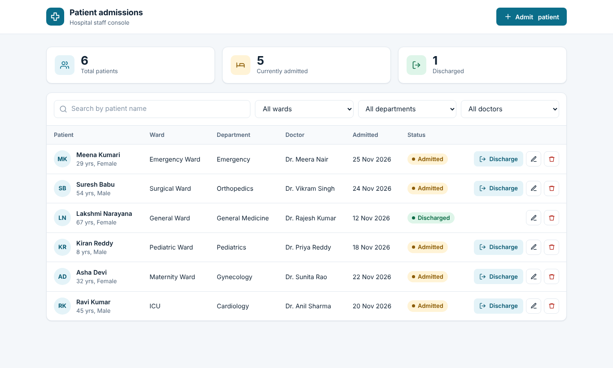
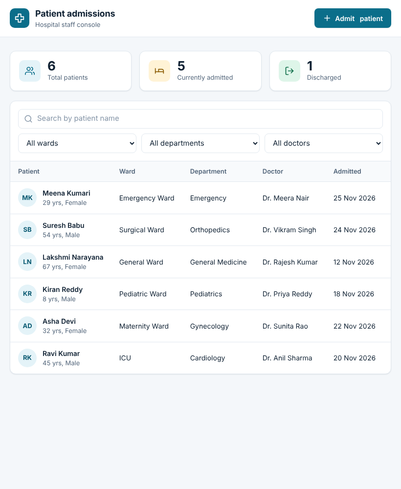
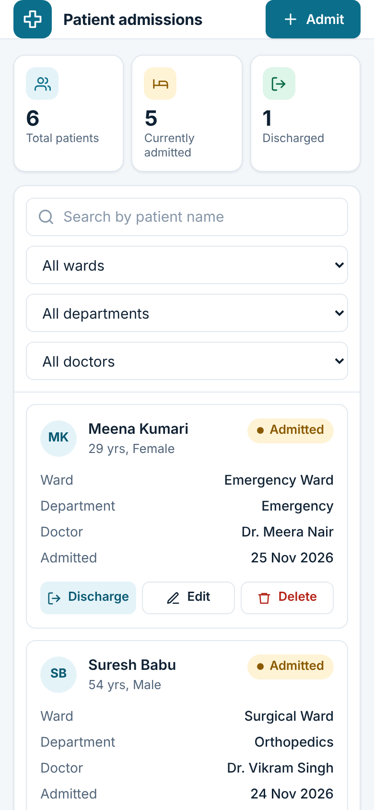
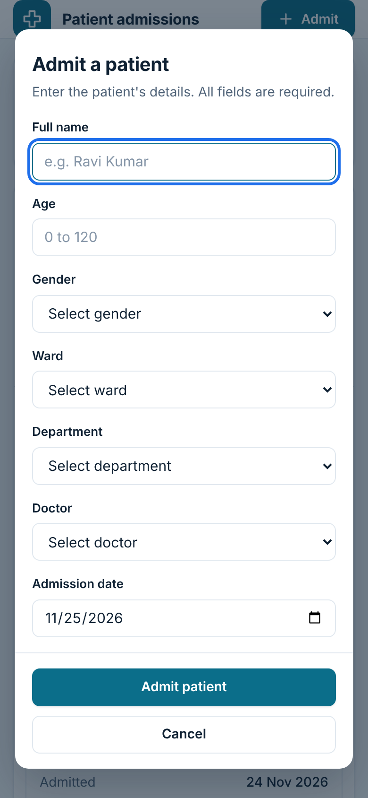
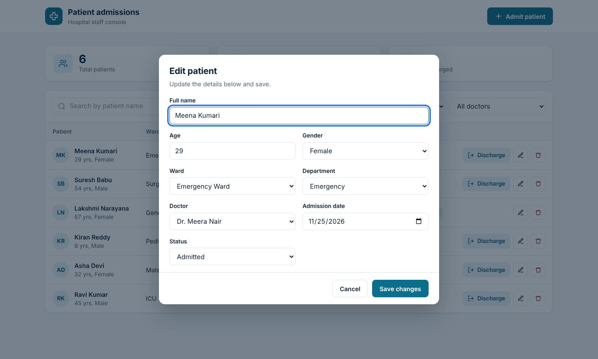
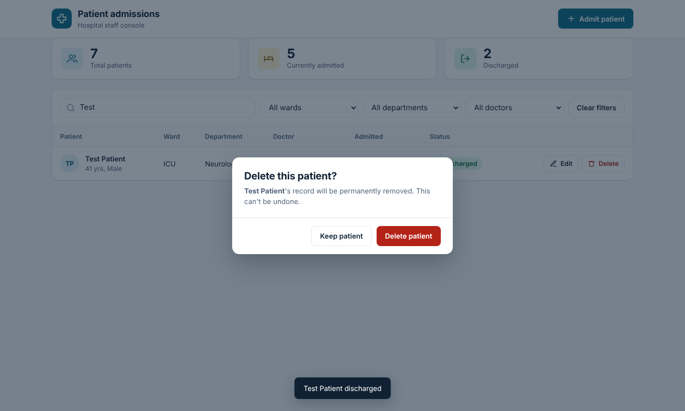

# Patient Admission Management App

Web app for hospital staff to manage admitted patients: add, list, search, filter, edit, delete (with confirmation) and discharge.

**Live link:** https://patient-admission-app.onrender.com
*(free hosting sleeps when idle; the first load can take ~50 seconds)*

## Tech stack
| Layer | Tech |
|---|---|
| Frontend | React 18 (Vite), plain CSS, responsive (mobile / tablet / desktop) |
| Backend | Python, FastAPI, SQLAlchemy |
| Database | PostgreSQL in production, SQLite locally (data survives restarts) |
| Hosting | Render (one Docker service serves the API and the React build) |

## Features
Add patient · view all · filter by Ward, Department, Doctor · search by name · edit · delete with confirmation · mark as Discharged · responsive layout.

## Validation (frontend and backend)
- Name: required, letters only
- Age: required, whole number from 0 to 120
- Gender, Ward, Department, Doctor: required, must be from the list
- Admission date: required, cannot be in the future
- The backend rejects bad data with HTTP 422 and a clear message, e.g. `{"message": "Validation failed: Age must be between 0 and 120", "errors": {"age": "Age must be between 0 and 120"}}`

## API
| Method | Path | Purpose |
|---|---|---|
| GET | `/api/options` | Lists for gender, ward, department, doctor |
| GET | `/api/patients?search=&ward=&department=&doctor=` | List, search, filter |
| POST | `/api/patients` | Add |
| PUT | `/api/patients/{id}` | Edit |
| PATCH | `/api/patients/{id}/discharge` | Mark discharged |
| DELETE | `/api/patients/{id}` | Delete |

## Run locally
Needs Python 3.10+ and Node 18+.

```bash
# 1. Backend (terminal 1)
cd backend
pip install -r requirements.txt
uvicorn main:app --reload --port 8000

# 2. Frontend (terminal 2)
cd frontend
npm install
npm run dev        # opens http://localhost:5173 (proxies /api to port 8000)
```

Run backend tests: `cd backend && pip install pytest httpx && pytest`

No secrets are stored in the repo. In production the database is set through the `DATABASE_URL` environment variable.

## Deploy (Render, free)
1. Push this repo to GitHub.
2. Render dashboard > **New > Blueprint** > select the repo > **Apply**.
3. `render.yaml` creates the Postgres database and the web service and connects them. Open the service URL when the deploy finishes.

## Screenshots
**Desktop**



**Tablet**



**Mobile**

 

**Add / edit form and delete confirmation**



